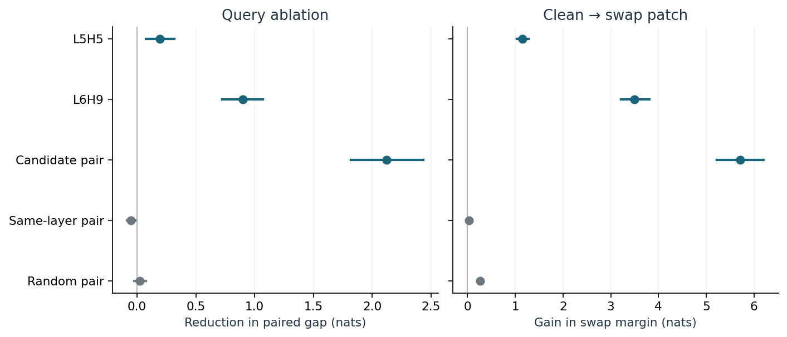

# CircuitScope

I wanted to know whether a specific part of GPT-2 Small helps it predict the token that followed an earlier occurrence of a cue. I measured a partial causal contribution from **L6H9**, one of the induction heads previously identified in GPT-2 Small. Transplanting its final-query output from a clean prompt into a swapped prompt moved the target-versus-foil margin by **3.50 nats** on average. Adding **L5H5** increased that recovery to **5.71 nats**, or **41.6%** of the intact behavioral gap.



Wang and colleagues previously found prefix matching and copying at both heads. I tested how much of a controlled cue swap these heads could transmit and how much of its effect survived ablation. [Wang et al., ICLR 2023, Appendix F](https://openreview.net/pdf?id=NpsVSN6o4ul)

## What I tested

Suppose the prefix contains `A B … C D` and ends with another `A`. I score whether GPT-2 prefers `B` to `D`. I then change the earlier pairs to `C B … A D` and ask the same question at the same final `A`. Both possible answers have the same counts, locations and distances to the query in both prompts. The correct continuation switches. A third prompt ends with a previously unseen cue.

I ranked all 144 heads by how much their attention followed that switch on 48 discovery pairs. I froze the top two heads and the control choices before evaluating 192 fresh pairs across three seeds. Layer and head indices start at zero.

| Held-out measurement | Mean | 95% paired interval |
| --- | ---: | ---: |
| Clean two-choice accuracy | 98.4% | 96.4% to 100% |
| Clean full-vocabulary top-1 accuracy | 51.6% | 44.3% to 58.9% |
| Clean minus swap target-versus-foil margin | 13.71 nats | 12.93 to 14.50 |
| Gap lost when I zeroed L5H5 and L6H9 | 2.12 nats | 1.82 to 2.43 |
| Swap margin gained when I patched both heads | 5.71 nats | 5.23 to 6.20 |

The target beat the designated foil on 189 of 192 clean prompts. On 90 of those wins, another token took first place across the 50,257-token vocabulary.

The highest attention score belonged to L5H5. L6H9 had the larger individual causal effect. Removing just the bound successor's weighted value from L6H9 reduced the gap by **1.23 nats**. Zeroing both heads still left an **11.59-nat** gap. I regard the source-to-head result as evidence for one route within a larger computation. [Full report and failure cases](docs/research_report.md)

## Reproduce the study

I ran OpenAI GPT-2 Small with PyTorch and Hugging Face Transformers using native eager attention hooks. I used a 12 GB RTX 4070 SUPER, an eight-prompt batch and FP16 weights. The primary runner took 23.65 seconds and peaked at 308.37 MiB of PyTorch-allocated GPU memory. My inputs are seeded synthetic GPT-2 token IDs. Anyone can regenerate them from the config.

After installing the pinned dependencies in a Python 3.12 environment, I use these commands from the repository root.

```sh
python -m pytest -q
python -m circuitscope.checkpoint
python -m circuitscope.run --device cuda --precision float16 --out reproduction
python -m circuitscope.figures reproduction
python -m circuitscope.precision_check reproduction
```

For CPU execution I use `--device cpu --precision float32`. The CPU tests check a tiny randomly initialized model and the saved study artifacts. They run offline. I included a CPU GitHub Actions workflow. [Installation, configuration and artifact guide](docs/reproduction.md)

## Research materials

- I audited head indexing with a second implementation, resampled the saved prompt pairs and reproduced the GPU run from a clean environment. [Scientific and publication audit](docs/audit.md)
- I recorded the hypothesis, falsification rules and analysis before measuring GPT-2. [Study protocol](docs/protocol.md) · [Supplementary source intervention](docs/source_intervention.md)
- I mapped the attention and intervention equations to their implementations. [Mathematical notes](docs/math.md)
- I included all prompt-level effects, head choices, summary intervals, runtime metadata and figures. [Measured results](results/)
- I pinned the model revision and verify its weights and config by SHA-256. [GPT-2 Small model card](https://huggingface.co/openai-community/gpt2)

## Licensing

I based the task on the repeated-cue induction behavior studied by Olsson and colleagues. I used OpenAI's public GPT-2 Small checkpoint, the Hugging Face implementation and PyTorch hooks. CircuitScope's code and documentation use the MIT license. The original checkpoint is available separately under its upstream license. [Induction heads paper](https://transformer-circuits.pub/2022/in-context-learning-and-induction-heads/index.html) · [GPT-2 upstream license](https://github.com/openai/gpt-2/blob/master/LICENSE) · [CircuitScope license](LICENSE)

The numerical claims can be checked against the committed trial table.

## Let's Connect

I’d welcome a conversation about what an attention head actually contributes inside a transformer. I can walk through the attention equations, why I chose a controlled cue swap, and how I used PyTorch hooks to test induction heads with activation patching and ablation. I’m especially happy to discuss how I developed the study, what the interventions support, and what I learned from the effect they left unexplained.

If you work on mechanistic interpretability or are exploring it, [say hello on GitHub](https://github.com/sslcat).
