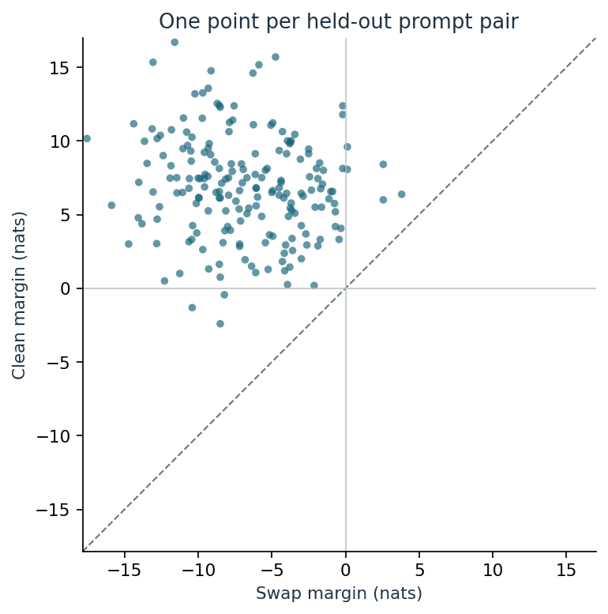
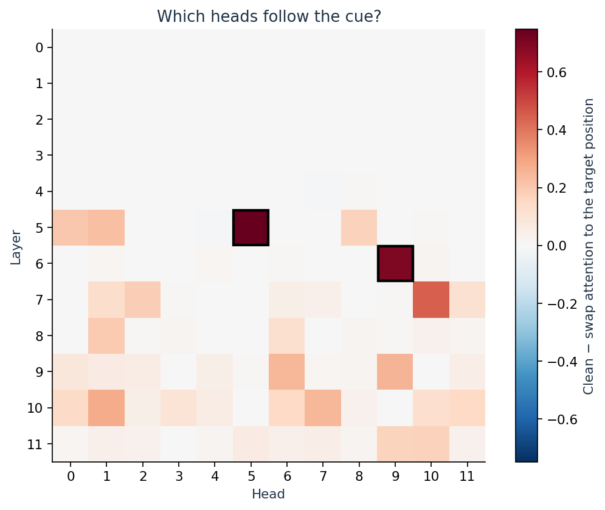
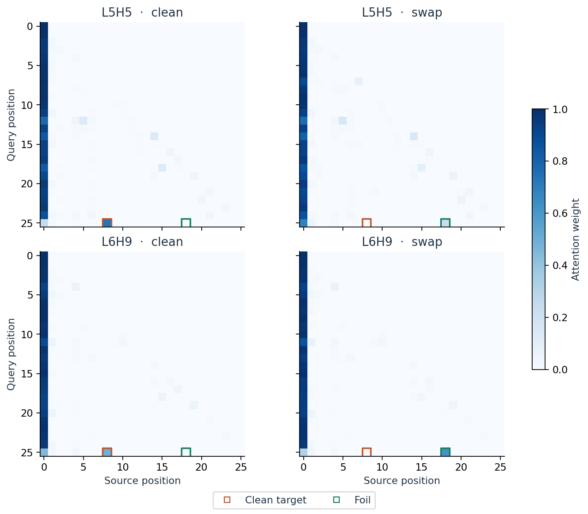
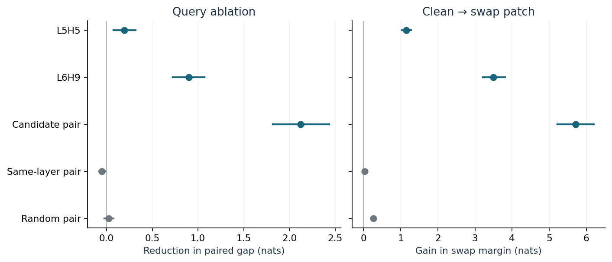

# CircuitScope research report

## Abstract

I tested whether GPT-2 Small uses identifiable attention heads to retrieve the token that followed an earlier occurrence of a cue. Swapping two earlier cues changed the target-versus-foil margin by 13.71 nats across 192 held-out pairs. I selected L5H5 and L6H9 on separate discovery prompts. Zeroing both final-query outputs removed 2.12 nats of the gap. Transplanting their clean outputs into the swapped context recovered 5.71 nats. Subtracting the cue-bound successor's weighted value from L6H9 alone removed 1.23 nats. These interventions identify a partial causal route. Most of the intact behavioral gap survived the joint zero ablation.

## Research question

When a cue occurs twice, does the model use an identifiable head to favor the token that followed its first occurrence? I wanted an experiment where token frequency, recent exposure to the answers and copying the current token could each be ruled out as a sufficient explanation for the paired effect.

## Background

Olsson and colleagues describe an induction head as completing a pattern of the form `A B … A → B`. I use one retrieval query per prompt and two possible successors. This lets me compare exactly the same answer tokens at fixed positions. Inspecting attention tells me which heads look at the right source. Testing their outputs and their individual source terms lets me measure which of those signals affects the model's prediction. [Olsson et al., 2022](https://transformer-circuits.pub/2022/in-context-learning-and-induction-heads/index.html)

## Hypotheses

I expected a positive clean-minus-swap margin gap. My causal prediction was that zeroing the two selected heads would shrink the gap and that patching them from clean to swap would move the swap margin toward the clean answer. I required each joint effect to exceed its same-layer and global control counterpart with a positive lower 95% endpoint. I specified that an interval spanning zero would leave that prediction unresolved. The smallest individual site had to pass the corresponding single-head comparisons. I also specified a supplementary comparison of bound and unbound source terms before inspecting the rankings. [Prospective protocol](protocol.md) · [Source-term design](source_intervention.md)

## Experimental setup

I used `openai-community/gpt2` at revision `607a30d783dfa663caf39e06633721c8d4cfcd7e`, with 124,439,808 parameters, 12 blocks and 12 heads per block. I ran inference in evaluation mode with eager attention, no KV cache and no gradients. I used native PyTorch hooks in Hugging Face GPT-2 so I could compare hooked outputs directly to the original forward pass. [Model card](https://huggingface.co/openai-community/gpt2) · [Hook implementation](../circuitscope/model.py)

I sampled 24 distinct IDs uniformly without replacement from 256 through 19,999, prepended BOS and appended a repeated cue. I sampled two disjoint adjacent pairs in the prefix and randomized their target/foil roles. Swapping the earlier cues left both successors, their counts, the final query and sequence length fixed. I used an unseen query as a neutral control. GPT-2 saw 26 positions and never saw the answer appended after the query.

I used discovery seed 1701 for 48 pairs and seeds 41, 43 and 47 for 64 held-out pairs each. My primary run used Python 3.12.15, PyTorch 2.8.0+cu128, Transformers 4.56.2, Windows, NVIDIA driver 610.88 and an RTX 4070 SUPER (12,282 MiB reported by the driver). I chose FP16 because other workloads occupied most dedicated VRAM at setup. The runner took 23.65 s including checkpoint verification, loading, discovery, interventions and aggregation. PyTorch peaked at 308.37 MiB allocated and 318.00 MiB reserved. Setup, figures and the separate FP32 check are outside that timer. [Run metadata](../results/run.json)

## Methods

I used the clean target and foil labels in every condition. My margin is the log probability of the target minus the log probability of the foil. My gap is the clean margin minus the swapped margin. I selected the two heads with the largest clean-minus-swap attention change from the query to the fixed target position. Before testing, I drew one different head in each selected layer and two additional global controls using seed 208.

I zeroed selected value-weighted head outputs at the final query just before the attention output projection. I measured the reduction in the gap, applying the same rule to both contexts. I patched selected clean outputs into aligned swapped positions and measured the resulting gain in the swap margin. For the source analysis I subtracted one source's attention weight times its value vector, keeping all other terms and the softmax denominator fixed. I recomputed downstream layers for every intervention. Each reported interval uses 2,000 paired bootstrap draws within seed, averaged equally across seeds. [Mathematics and code mapping](math.md)

## Results

| Intact condition | Target log probability | Target − foil margin, nats [95% interval] | Target wins two-choice | Target is vocabulary top-1 |
| --- | ---: | ---: | ---: | ---: |
| Clean repeated cue | −4.16 | 6.88 [6.38, 7.37] | 98.4% | 51.6% |
| Swapped earlier cues | −10.90 | −6.83 [−7.40, −6.27] | 2.6% | 0.0% |
| Novel query | −10.78 | 0.20 [−0.22, 0.65] | 51.8% | 0.0% |

I measured a mean paired gap of **13.71 [12.93, 14.50] nats** and a clean target loss saving of **6.74 [6.31, 7.17] nats**. The target won against the foil on 189/192 clean prompts but won against the entire vocabulary on only 99/192. The novel-query interval covers zero. This gives the relative preference shift a narrower interpretation than unrestricted next-token prediction.

On discovery prompts, L5H5 scored 0.748 and L6H9 scored 0.700 in attention-probability units. L7H10 ranked third at 0.446. The first heatmap shows all 144 head scores. The second shows the first discovery prompt. The marked cells are the two answer positions in the final query row. I selected that example by index.

## Causal intervention findings

| Site, zero-based | Gap lost to ablation, nats [95% interval] | Swap margin restored by patch, nats [95% interval] |
| --- | ---: | ---: |
| L5H5 | 0.19 [0.07, 0.32] | 1.15 [1.03, 1.28] |
| L6H9 | 0.90 [0.72, 1.07] | 3.50 [3.21, 3.81] |
| Both candidates | 2.12 [1.82, 2.43] | 5.71 [5.23, 6.20] |
| Same-layer pair, L5H10 + L6H11 | −0.05 [−0.08, −0.01] | 0.03 [0.02, 0.04] |
| Global pair, L10H2 + L8H2 | 0.03 [−0.02, 0.08] | 0.26 [0.20, 0.32] |
| All 12 query heads in layer 5 | 1.94 [1.74, 2.17] | — |
| All 12 query heads in layer 6 | 0.95 [0.75, 1.13] | — |

I compared effects within each prompt. The joint ablation exceeded the same-layer pair by 2.17 [1.87, 2.48] nats and the global pair by 2.09 [1.79, 2.41]. The corresponding patch advantages were 5.68 [5.20, 6.17] and 5.45 [4.97, 5.93]. The prespecified joint predictions passed. On neutral prompts, joint zeroing moved the margin by −0.047 [−0.119, 0.031] nats (intact minus ablated). This neutral comparison measures a signed target preference; unrelated changes can cancel in that average.

**Smallest supported route.** L6H9 passed both individual control comparisons under each intervention. Removing its bound successor's weighted value reduced the gap by 1.23 [1.06, 1.42] nats. Removing the other answer's term yielded −0.010 [−0.018, −0.002]. The paired specificity contrast was 1.24 [1.07, 1.43]. My minimal tested account is that the earlier successor supplies value information to L6H9 at the final query, and the downstream model uses that write to favor the bound answer. The experiment leaves open which upstream components enable cue matching.

**Contribution of L5H5.** Its bound-minus-other source contrast was 0.33 [0.23, 0.44] nats. Its patch exceeded both assigned control patches. Its individual ablation advantage over global control L10H2 was 0.06 [−0.06, 0.18], leaving that comparison unresolved. The same-layer controls' bound-minus-other contrasts were 0.020 for L5H10 and 0.007 for L6H11. A source term can have a larger effect than removing the whole head because the latter removes every source term.

**Joint effects.** The pair exceeded the sum of the individual effects by 1.02 [0.88, 1.17] nats under ablation and 1.06 [0.82, 1.30] under patching. These observations establish nonadditivity on the margin scale. Downstream nonlinearities could produce it. A directed L5H5-to-L6H9 connection remains hypothetical.

The pair removed 15.5% of the mean intact gap under zeroing and restored 41.6% under transplantation. These are ratios of means for different interventions. Although the patch increased the swap margin on all 192 pairs, the mean patched margin was still −1.13 nats, and only 76/192 patched margins favored the clean target.

## Robustness checks

| Held-out seed | Intact gap | Joint ablation loss | Joint patch gain |
| --- | ---: | ---: | ---: |
| 41 | 13.61 | 1.91 | 5.83 |
| 43 | 14.52 | 2.26 | 6.20 |
| 47 | 13.01 | 2.19 | 5.10 |

All entries are seed means in nats. A second full GPU run reproduced the trial CSV, head groups and summary JSON byte for byte. Every saved discovery array also matched exactly. On the first batch of each seed, self-patching reproduced every swap logit and transplanting the entire final residual reproduced every clean logit with zero maximum absolute error. In a separate CPU FP32 rerun of the first eight seed-41 pairs, the intact gap, joint ablation loss and joint patch gain averaged 12.85, 1.96 and 5.61 nats. The corresponding GPU FP16 means were 12.84, 1.98 and 5.61. The largest per-trial discrepancies were 0.156, 0.088 and 0.087 nats. [Precision check](../results/precision_check.json)

I also inspected failures. On seed 47, trial 55, the clean model preferred the foil by 2.41 nats and the joint patch gained just 0.44 nats. Joint ablation enlarged the gap on 24 trials and left it unchanged on one. On seed 43, trial 32, it enlarged the gap by 2.84 nats. I use zero-based trial indices so each example can be regenerated directly. [Per-trial measurements](../results/trials.csv)

## Limitations

I tested a single checkpoint, one prefix length, one vocabulary range and one synthetic distribution with unique prefix tokens. The swap changes the contextual representations of surrounding tokens as well as the cue-successor binding. The controlled endpoint measures their combined downstream effect. A novel query changes the query identity, which limits interpretations of the neutral comparison.

I used one fixed discovery sample and one random draw of comparison heads. My intervals quantify held-out prompt variation conditional on those choices. They are pointwise and exclude model, discovery and control-selection uncertainty. Zeroing and cross-context patching can create unusual internal states. I intervened at the final query only. The 11.59-nat mean gap after joint ablation leaves substantial behavior to explain. The FP32 comparison covers eight pairs.

## Conclusions

I found a causal contribution to in-context copying from GPT-2 Small's L6H9 on this task. Its effect survived head controls, and the particular value arriving from the bound successor mattered. L5H5 carried additional patchable information, and joint interventions produced larger effects than the sum of the individual ones. I have identified part of the computation. The upstream cue-matching mechanism, the remaining routes and the extent of transfer to natural text are open questions.

## Future work

I would first perturb candidate previous-token inputs to L6H9's keys while holding other paths fixed. That would test how the successor becomes addressable by its preceding cue. I would then repeat discovery across prompt lengths, token ranges and resampled control sets, and compare zero ablation to matched resampling. A natural-text continuation task would test how far these synthetic results transfer.

I used OpenAI Codex for implementation, execution, verification and drafting. I include the raw trial table and scripts so the evidence can be reanalyzed independently.
